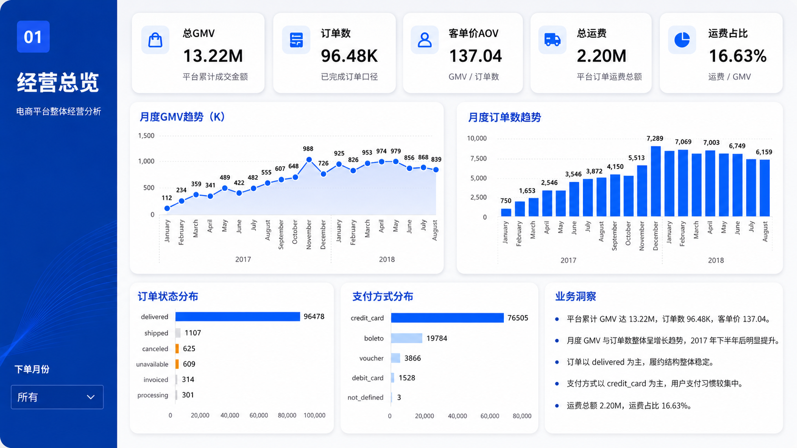
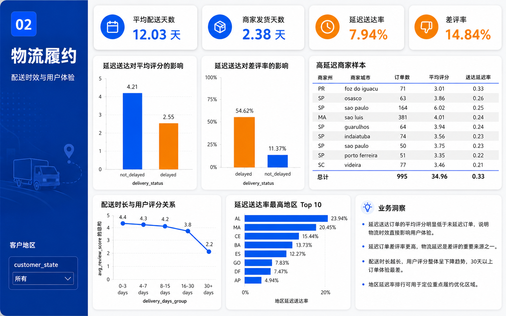
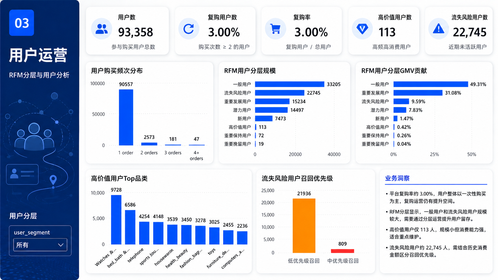
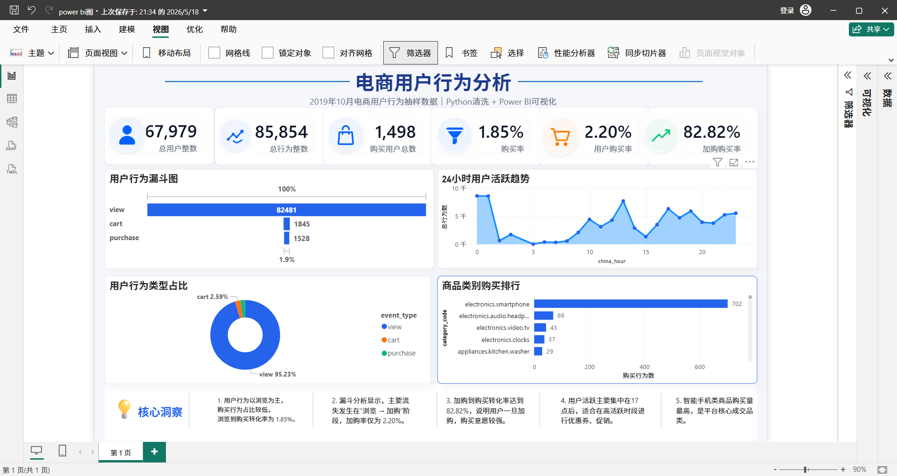

# 罗方宇｜数据分析作品集

面向 **数据分析实习 / 业务分析实习 / 数据运营实习**，展示从数据清洗、SQL 建模、指标分析到 Power BI 看板和业务复盘的项目成果。

**[在线浏览作品集](https://hkkk66543-oss.github.io/Data-Analysis-Portfolio/)** · [网页源文件](index.html) · [可视化截图](images/)

## 项目导航

| 项目 | 业务主题 | 技术栈 | 已有成果与入口 |
| --- | --- | --- | --- |
| SQL 电商平台经营分析 | 经营表现、物流履约、用户价值 | MySQL、SQL、Navicat、Excel、Power BI | 16 张 ADS 指标表、3 页看板；[项目仓库](https://github.com/hkkk66543-oss/sql-ecommerce-analysis) |
| Python 电商用户行为分析 | 行为结构、活跃时段、商品类别 | Python、Pandas、Jupyter Notebook、Excel、Power BI | 分块抽样、数据清洗、行为统计与可视化；[项目仓库](https://github.com/hkkk66543-oss/E-commerce-User-Behavior-Analysis) |
| AI 数据分析自动化工作流 | 分析流程标准化与交付规范 | AI 辅助分析、SQL 分层建模、QA、Power BI 页面规划 | 分阶段执行提示词、命名规范、校验清单和交付模板；[项目仓库](https://github.com/hkkk66543-oss/ai-data-workflow) |

## 技术能力

| 能力 | 项目中的实践 |
| --- | --- |
| SQL / MySQL | 多表关联、清洗明细表建设、ODS → DWD → ADS 分层建模、业务指标汇总 |
| Python / Pandas | 大文件分块读取与抽样、去重、缺失值和异常价格处理、时间字段转换与特征提取 |
| Power BI | 经营总览、物流履约、用户运营看板，以及用户行为、活跃趋势、品类购买分析 |
| Excel | 数据检查与校验，辅助分析结果整理 |
| 业务分析 | GMV、订单数、AOV、物流时效、评价、复购和 RFM 用户价值分析 |
| 分析流程与 QA | 数据理解、字段检查、指标口径整理、SQL 结果校验及看板交付规划 |

## 项目一：SQL 电商平台经营分析

基于 **Kaggle Olist 多表电商数据**，使用 MySQL / Navicat 完成数据导入、关联与清洗，建设 ADS 指标表，并通过 Power BI 展示经营、物流和用户运营结果。

**已有交付：**16 张 ADS 指标表、3 页 Power BI 看板、SQL 文件、ADS 汇总样例数据及分析流程和指标口径文档。

### 分析内容与成果

- **经营总览：**展示 GMV、订单数、AOV、运费占比、月度趋势、订单状态和支付方式结构。
- **物流履约：**比较延迟与未延迟订单的评分、差评率和配送时长，识别地区与商家的履约风险。
- **用户运营：**分析购买频次、复购率、RFM 分层、高价值用户和流失风险用户，支持分层维护与召回。

**已由仓库汇总样例支持的业务发现：**

- 复购率约 **3%**：样例中 93,358 名用户、2,801 名复购用户，用户以一次性购买为主，可进一步探索留存与复购运营。
- 延迟送达订单平均评分 **2.55**，未延迟订单为 **4.21**；差评率分别为 **54.62%** 和 **11.37%**。这体现了物流时效与用户评价的关联，可作为履约改善的分析依据。
- RFM 分层用于比较不同用户群体的规模和 GMV 贡献，形成高价值用户维护和流失风险用户召回的分析方向。

上述数字来自项目仓库的 [复购汇总样例](https://github.com/hkkk66543-oss/sql-ecommerce-analysis/blob/main/data_sample/ads_repurchase_overview.csv) 和 [延迟送达与评价对比样例](https://github.com/hkkk66543-oss/sql-ecommerce-analysis/blob/main/data_sample/ads_delay_review_impact.csv)。它们是历史数据分析结果；运营建议尚不代表已实现的业务提升，组间对比也不直接证明因果关系。

### 可视化截图

**经营总览**

**物流履约**

**用户运营**

[查看项目说明、SQL 与看板文件 →](https://github.com/hkkk66543-oss/sql-ecommerce-analysis)

## 项目二：Python 电商用户行为分析

基于 **2019 年 10 月电商用户行为数据**，使用 Python / Pandas 分块读取并抽样，完成清洗、时间字段处理和行为统计，再结合 Power BI 展示分析结果。

### 分析内容与成果

- **数据清洗：**去除重复记录，处理缺失值与零价格异常记录。
- **时间特征：**将 UTC 时间转换为 UTC+8，提取小时、日期、星期等字段。
- **行为结构：**统计浏览、加购、购买事件，展示各类行为的数量与占比。
- **活跃趋势：**分析 24 小时内的行为变化，为运营活动时间选择提供参考。
- **商品类别：**比较不同类别的购买表现，识别重点分析和运营方向。

**分析口径：**本项目基于分块抽样后的数据，结果适用于该样本。浏览、加购、购买事件的数量比较，不等同于同一用户按时间顺序完成的转化漏斗；用户或会话层面的转化需要另行匹配与验证。

### 可视化截图

[查看 Python 分析项目与 README →](https://github.com/hkkk66543-oss/E-commerce-User-Behavior-Analysis)

## 项目三：AI 数据分析自动化工作流

围绕从数据理解到看板交付的分析流程，整理可复用的 **数据分析 SOP 与提示词母版**，规范项目执行、校验和交付。

### 已有流程与模板

- 数据理解、行业识别、业务主题及指标确认。
- SQL 命名与保存规范，以及 ODS / DWD / ADS 分层建模流程。
- 字段检查、数据质量检查与 SQL 结果 QA 校验。
- Power BI 页面规划、DAX 与页面操作说明。
- 分析报告、README、简历描述及面试讲解稿的交付规划。

**成果定位：**这是可复用的分析流程与模板，不作为新增业务分析案例，也不宣称未经测量的效率提升。实际业务结论与最终看板仍需依赖真实数据和校验结果。

[查看工作流说明与模板 →](https://github.com/hkkk66543-oss/ai-data-workflow)

## 访问与阅读说明

- **快速了解：**阅读本 README 的项目导航、技术能力与分析成果。
- **查看完整展示：**访问 [GitHub Pages 作品集](https://hkkk66543-oss.github.io/Data-Analysis-Portfolio/)。
- **检查实现与口径：**进入对应项目仓库，查看 SQL、Notebook、汇总数据和项目说明。
- **查看展示资源：**本仓库 [index.html](index.html) 为作品集网页，[images/](images/) 保存四张已有截图。

本作品集汇总已有项目与展示资源，不包含新增的未完成项目或未经验证的业务改善数据。
